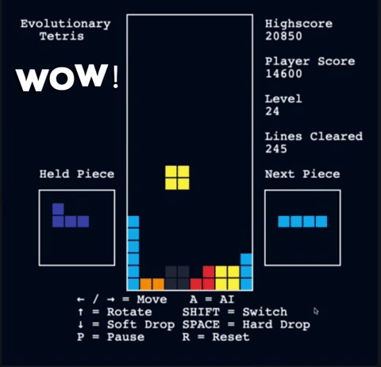
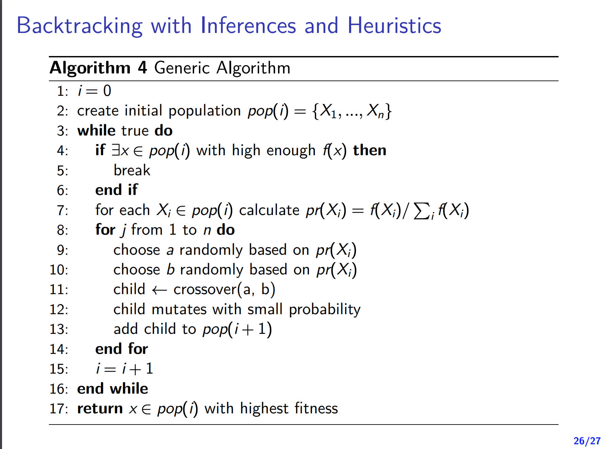
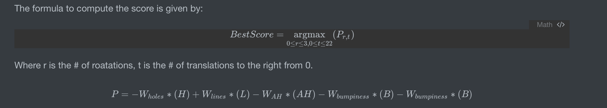

## Table of contents

- [Evolutionary Tetris](#evolutionary-tetris)
- [Formal Document](#formal-document)
- [Acknowledgement](#acknowledgement)
- [Demo](#demo)
- [Genetic Algorithm](#genetic-algorithm)
- [Heuristic](#heuristic)
- [Results](#results)
- [Run locally](#run-locally)
- [Code layout](#code-layout)
- [Fun Stuff](#fun-stuff)

## Evolutionary Tetris
This AI uses an evolutionary technique to improve over time. Through selection, crossover, and mutation, the AI learns to play [Tetris](https://en.wikipedia.org/wiki/Tetris) and clear as many lines as possible.

## Formal Document
Here's a document that explains the details of the algorithm and the derivation of my heuristic functions.
https://catnip-chiller-6ba.notion.site/CS208-Final-Project-00b752eb61fa45e4ab4e5bd92751cd1b

## Acknowledgement

- [CS486: Intro to AI](https://cs.uwaterloo.ca/~a23gao/cs486_f18/slides/lec08_csp_local_search_nosol.pdf)
- [Building A Tetris Bot Part 2: Genetic Algorithms](https://medium.com/@omgimanerd/building-a-tetris-bot-part-2-genetic-algorithms-889fc66006b1)

## Demo
[Live Demo](https://segfault2017.github.io/EvoluationaryTetris/)



Press **A** in the game to hand control to the AI.

## Genetic Algorithm


Genetic algorithms work by creating a population of "genomes" that have multiple "genes", representing parameters for the algorithm. Each individual in the population is evaluated and gets a "fitness" score. The fittest individuals reproduce and pass favourable genes down to the next generation. Mutation also occurs, where genes are randomly modified in the hope of creating more beneficial features.

The weights were tuned offline with this process. **The training code is not part of this repo.** The game ships the resulting weights, hardcoded in [`src/main.js`](src/main.js).

## Heuristic
For each new piece, the AI tries every rotation and every column. Since the next piece is shown, it then tries every placement of that piece too, and scores each move by the best board the pair can produce (a two-ply lookahead). It plays the move with the highest score; a move that leaves the next piece nowhere to spawn counts as a loss. The score is based on four features, each of which the AI tries to minimise or maximise:



where P is the score of a placement and

- H: the number of holes after the piece has landed
- L: the number of completed lines after the piece has landed
- AH: the aggregate height, the sum of all column heights after the piece has landed
- B: the bumpiness, the sum of the height differences between every two adjacent columns

The image above repeats the bumpiness term by mistake. The code uses exactly four terms: `P = -W_AH·AH + W_lines·L - W_holes·H - W_bumpiness·B`.

## Results
After 50 generations, the tuned weights are:
- Aggregate height: 0.51
- Holes: 0.36
- Lines cleared: 0.76
- Bumpiness: 0.18

Measured with `npm run bench` (seeded games, so the numbers repeat):

| Search | Mean lines per game | Seeds |
|---|---|---|
| Greedy, current piece only | 670 (median 361) | 10 |
| Two-ply lookahead with the next piece | 11,778 (one game still alive at the 50,000-piece cap) | 3 |

The lookahead is about 35× more work per piece, roughly 3 ms, which is invisible at the game's drop speed.

## Run locally
ES modules don't load from `file://`, so serve the folder with any static server:

```bash
python3 -m http.server 8000
# open http://localhost:8000
```

Run the tests (Node 18+, no dependencies):

```bash
npm test
```

Measure how many lines the AI clears per game (defaults: 5 seeded games, 2000 pieces each):

```bash
npm run bench            # or: node test/bench.js <games> <maxPieces>
```

## Code layout

```
src/core/pieces.js   piece shapes and rotation
src/core/board.js    collision, line clearing, board metrics
src/core/ai.js       move search and scoring
src/core/game.js     game state and rules (no DOM)
src/ui/render.js     canvas drawing
src/ui/input.js      keyboard controls
src/main.js          wiring, game loop, tuned weights
test/                node --test suites, plus bench.js (lines per game)
```

Plain JavaScript, HTML and CSS: no build step and no dependencies.

## Fun Stuff
- A [Unity version](https://github.com/SegFault2017/Tetris-With-AI) is available here.
- [Is it possible to play Tetris forever?](https://tetris.fandom.com/wiki/Playing_forever)
